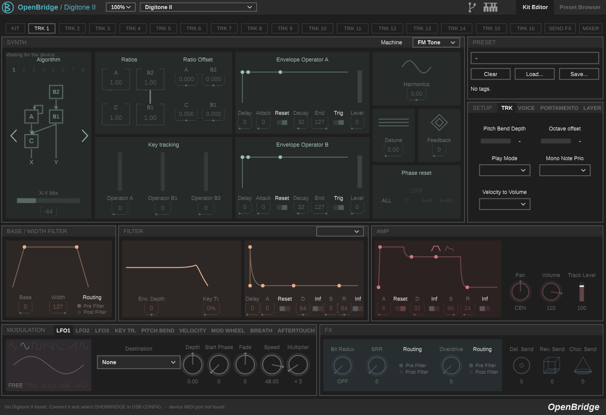

# OpenBridge – Digitone II

Linux implementation of Elektron Overbridge for the **Elektron Digitone II**:



## Features

- **Multichannel USB audio**: Main, Track 1–16, FX and Ext-In outputs (42 channels) and the 8
  inputs, with clock-drift compensation between the DAW and the device.
- **Every sound parameter** of the 16 tracks (FM Tone, FM Drum, WaveTone, Swarmer, MIDI machines;
  all filter machines), read from the device and editable, with DAW automation.
- **Editor**: machine pages, filter, amp, LFOs, modulation (key tracking,
  pitch bend, velocity, mod wheel, breath, aftertouch), SETUP (TRK, VOICE, PORTAMENTO, LAYER),
  send FX, mixer with level meters, compressor, Ext-In, on-screen keyboard.
- **Mixer**: track levels, mutes, pattern mutes, solo, pan, send FX, master and compressor,
  read from the device when the plugin opens.
- **Preset Browser**: kit track presets, +Drive library (banks A–H, tags, filters); load a
  +Drive preset into a track; Clear a track.

## Requirements

- Linux x86_64, **Ubuntu 22.04 or later** (or a distribution with glibc 2.35 or later).
- An Elektron Digitone II on **OS 1.12 or later**. Older OS versions do not answer the mixer and FX messages.

## Installation

### .deb package (Ubuntu / Debian)

Download `openbridge-digitone2_0.1_amd64.deb` from the
[Releases](https://github.com/Donmanouche/OpenBridge-Digitone-2/releases) page, then:

```bash
sudo apt install ./openbridge-digitone2_0.1_amd64.deb
```

It installs:

- the VST3 plugin in `/usr/lib/vst3/OpenBridge Digitone II.vst3`;
- a udev rule that gives the logged-in user access to Elektron USB devices.

Unplug and replug the Digitone after installing.

### Archive

`openbridge-digitone2-0.1-linux-x86_64.tar.gz` holds the same files.

1. Copy `OpenBridge Digitone II.vst3` to `~/.vst3/`.
2. Install the udev rule:

   ```bash
   sudo cp 70-openbridge-elektron.rules /etc/udev/rules.d/
   ```

   ```bash
   sudo udevadm control --reload-rules
   ```

## Building from source

Dependencies (Ubuntu 22.04 package names):

```bash
sudo apt install build-essential cmake ninja-build pkg-config libusb-1.0-0-dev libsamplerate0-dev libasound2-dev libjack-jackd2-dev libfreetype-dev libx11-dev libxext-dev libxrandr-dev libxinerama-dev libxcursor-dev
```

You also need **JUCE 7**, in one of two ways:

- **Packaged JUCE**: install the `juce-modules-source` package (Ubuntu 24.04 and later, Debian).
- **JUCE sources**: download [JUCE 7.0.5](https://github.com/juce-framework/JUCE/releases/tag/7.0.5)
  and pass its folder with `-DOB_JUCE_DIR=/path/to/JUCE`.

```bash
cmake -S . -B build -G Ninja -DCMAKE_BUILD_TYPE=Release
```

```bash
ninja -C build
```

The plugin is in `build/OpenBridgeDigitone2_artefacts/Release/VST3/`.

## Not available yet

- **Delay time**: shown as a raw value, not as a note length.

## Disclaimer

OpenBridge is an independent project. It is not affiliated with, endorsed or supported by Elektron.
Elektron, Overbridge and Digitone are trademarks of Elektron Music Machines MAV AB. Use it at your
own risk.

## License

GPL-3.0. See [LICENSE](LICENSE). Built with [JUCE](https://juce.com) under its GPL licence.
